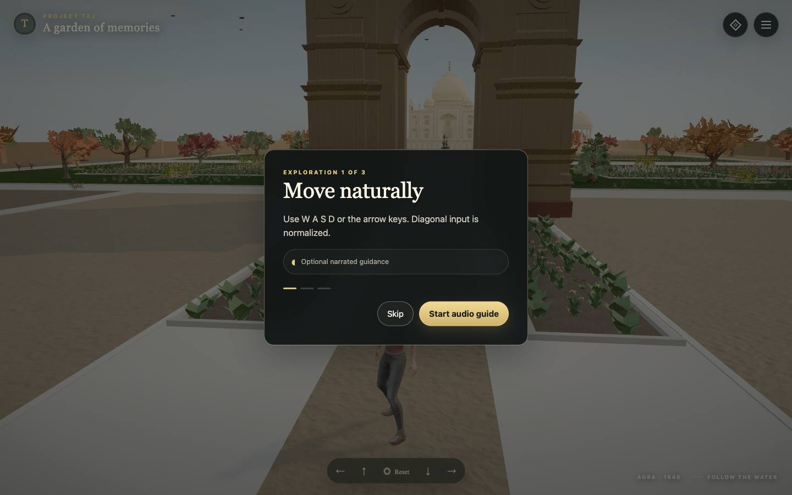
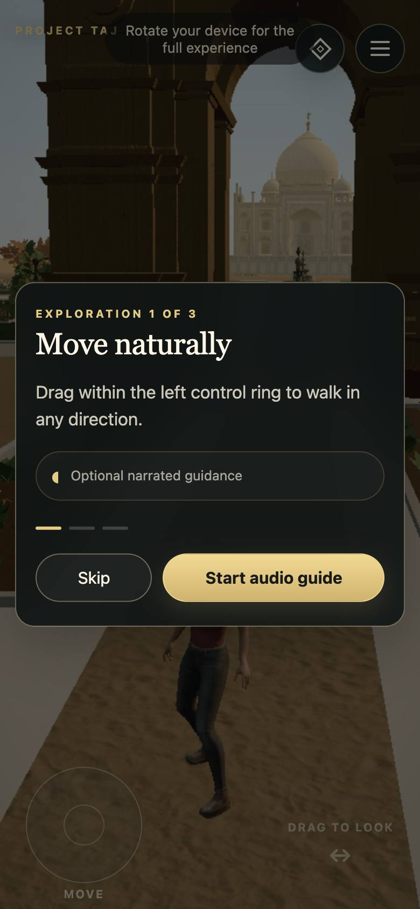

# Project Taj

> A third-person 3D exploration game set in a stylised Taj Mahal garden.

**Live:** [project-tajmahal.vercel.app](https://project-tajmahal.vercel.app)

<p align="center">
  
  
</p>


Project Taj is a third-person 3D narrative exploration game set in a stylized
Taj Mahal garden. Players recover seven authored memories, climb the exterior
Taj stairs, and reach a narrated final letter. The mausoleum interior remains
intentionally inaccessible.

## Stack

React 18, TypeScript, Vite, React Three Fiber, Three.js, Rapier, Zustand,
Framer Motion, Vitest, and Playwright.

## Development

```bash
pnpm install
pnpm dev
```

The development server defaults to `http://localhost:5173`.

```bash
pnpm typecheck
pnpm test
pnpm build
pnpm content:lint
pnpm lint
```

`pnpm lint` enforces zero warnings.

Set `VITE_ENABLE_DEBUG_TOOLS=true` in `.env.local` to enable traversal,
interaction, lighting, audio, and code-authored Taj review diagnostics.
Generated captures are written under `artifacts/review/` and are intentionally
git-ignored.

## Production Assets

Vite copies everything under `public/` into the production build. Only
runtime-used models, textures, audio, and the HDR environment belong there.
Source archives and licence evidence live under `content/`; generated review
captures and raw audit packs do not belong in production.

The approved release evidence is retained in `artifacts/release-candidate/`.
Asset attribution and provenance are recorded in `content/credits.json` and
the production derivative inventory in `content/assets.manifest.json`.

## Documentation

- [Architecture](ARCHITECTURE.md)
- [Conventions](CONVENTIONS.md)
- [Final experience audit](docs/phase-11/phase-11-final-experience-audit.md)
- [Production audio](docs/phase-11.5/README.md)
- [Narration licence](docs/audio/narration-license.md)

## License

Code is released under the [MIT License](LICENSE). Photos, video, artwork, audio and written content are not covered by it: personal media is © Prawal Sharma, all rights reserved, and third-party assets remain under their own licenses.
